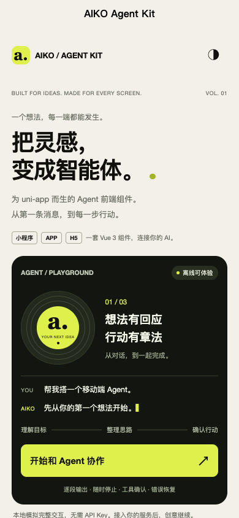
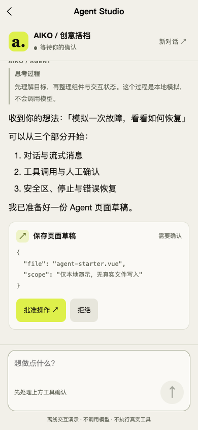

# Uniapp-AIKIT · AIKO Agent Kit

为 uni-app Vue 3 开发者准备的移动端 Agent 前端组件说明与 Vibe Coding 规范。

> [在线预览 ↗](https://uniapp-aikit.pages.dev/) · [Agent Studio](https://uniapp-aikit.pages.dev/#/pages/demos/agent-studio/index) · [Vibe Coding 指南](https://uniapp-aikit.pages.dev/#/pages/guide/index)
> [DCloud 插件市场](https://ext.dcloud.net.cn/plugin?id=28709) · [Vibe Coding 规范](docs/VIBE_CODING.md) · [跨端能力](docs/COMPATIBILITY.md) · [验证记录](docs/VALIDATION.md)

## 把灵感，变成智能体

暖米白、近黑和荧光绿的 AIKO Studio 视觉；38 个可搜索的演示；从第一条消息到人工确认的 Agent 交互。

| 移动端首页 | Agent 工具确认 |
| --- | --- |
|  |  |

## 可以用它完成什么

- 用 AiAgentSession 快速搭建完整会话，或用 useAgent 和独立组件定制布局。
- 呈现 Markdown、逐段回复、推理、工具输入/结果、来源、计划和代码。
- 支持停止、迟到事件隔离、错误恢复、工具批准和拒绝。
- 全端缓冲 JSON、uni WebSocket；H5 POST SSE；自定义原生适配器。
- AiTheme 将明暗主题通过 Vue 节点传给小程序、App-vue 和 H5。

## 开发文档

1. [Vibe Coding 开发契约：安装、最小页面、API、提示词](docs/VIBE_CODING.md)
2. [基础组件使用目录](docs/components/README.md)
3. [机器可读组件导出清单](docs/component-manifest.json)
4. [跨端能力与降级约定](docs/COMPATIBILITY.md)
5. [实际验证范围](docs/VALIDATION.md)

组件使用源码应从插件市场取得。本仓库只公开文档、接口清单和截图，不包含收费组件实现或源码授权包。

## 给编码 Agent 的起步提示词

> 使用 uni-app Vue 3 和 AIKO Agent Kit，做一个面向【用户】的【场景】Agent 页面。先读 docs/VIBE_CODING.md、docs/component-manifest.json 和已安装插件里的实际组件类型。目标端为【微信 / App-vue / H5】，按 Studio 视觉实现。先用离线 Transport 验证发送、停止、错误、审批接受/拒绝，再接【后端地址与协议】。报告真实执行的检查和未验证的端。

## 接入与验证范围

目标为 uni-app Vue 3 的小程序、App-vue、H5，不包含 nvue / uni-app-x。演示不调用模型，也不执行真实工具。模型协议转换、鉴权、真实工具执行与幂等由服务端负责。

2026-11-06：18 项自动测试、类型检查，以及 H5 / 微信 / 支付宝 / App-vue 构建通过；H5 在浏览器验证了主要交互。小程序开发者工具与 Android/iOS 真机尚未运行，具体以验证记录为准。

Nexus Wang · 保持热爱、好奇心和创造力。
